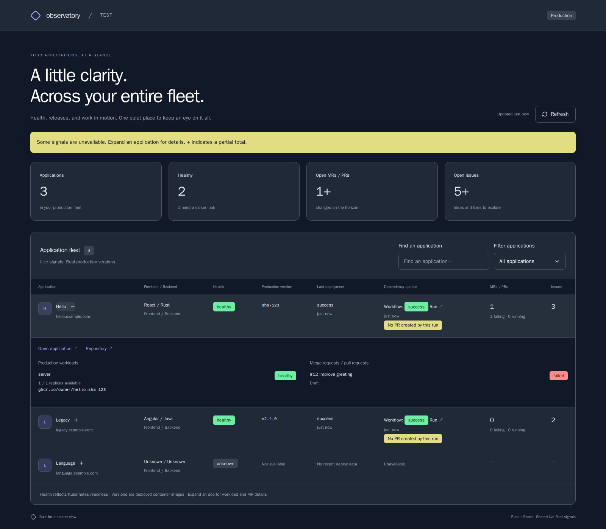
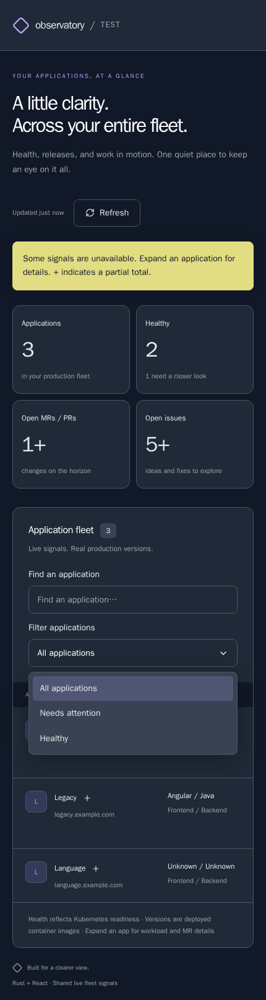
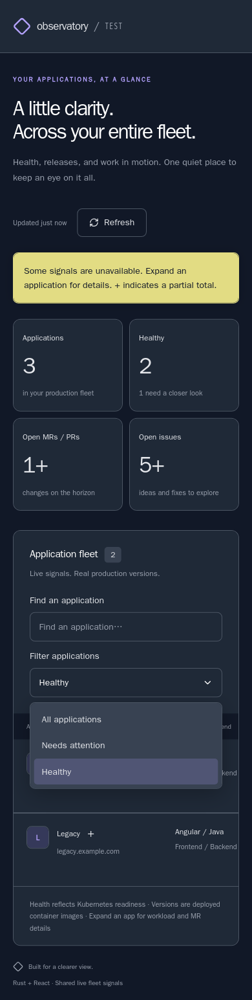

# Dashboard visual review

Screenshots of the production React bundle served by the Rust backend, using
illustrative end-to-end fixture data. These are visual-review images, not live
production signals or pixel-diff test baselines.

The dashboard uses React UI controls, cards, semantic badges, and alerts, with
application layouts scoped through CSS Modules.

The fleet shows **React / Rust**, **Angular / Java**, and an undetected stack as
**Unknown / Unknown**.

## Desktop

1600 px viewport, showing the complete fleet table.


## Mobile

430 px viewport, with the horizontally scrollable table positioned to show the
frontend and backend stack column.


## Expanded application

Desktop disclosure showing full image references, replica readiness, and PR checks.



## Mobile filter menu

The portaled React UI select remains inside the mobile viewport and inherits the
application theme.



## Mobile WebKit

iPhone 13 emulation, including touch interaction and React Aria's mobile overlay
scroll-containment style under the production CSP.



## Regenerate

Requires the built frontend, Rust binary, and Playwright browsers. The capture
script starts an isolated Rust server and intercepts only fleet API responses
with illustrative E2E data. It rejects browser errors and mobile document overflow.

```bash
cargo build --locked
npm --prefix frontend run build
npm --prefix frontend exec -- playwright install chromium webkit
SCREENSHOT_WEBKIT=1 npm --prefix frontend run screenshots
```

Without `SCREENSHOT_WEBKIT=1`, the script captures the four Chromium images.

The WebKit run verifies application errors before its final screenshot: Playwright
injects a temporary `body {}` repaint stylesheet during capture, which the real
CSP correctly rejects. This tooling-only style does not affect the captured pixels.
