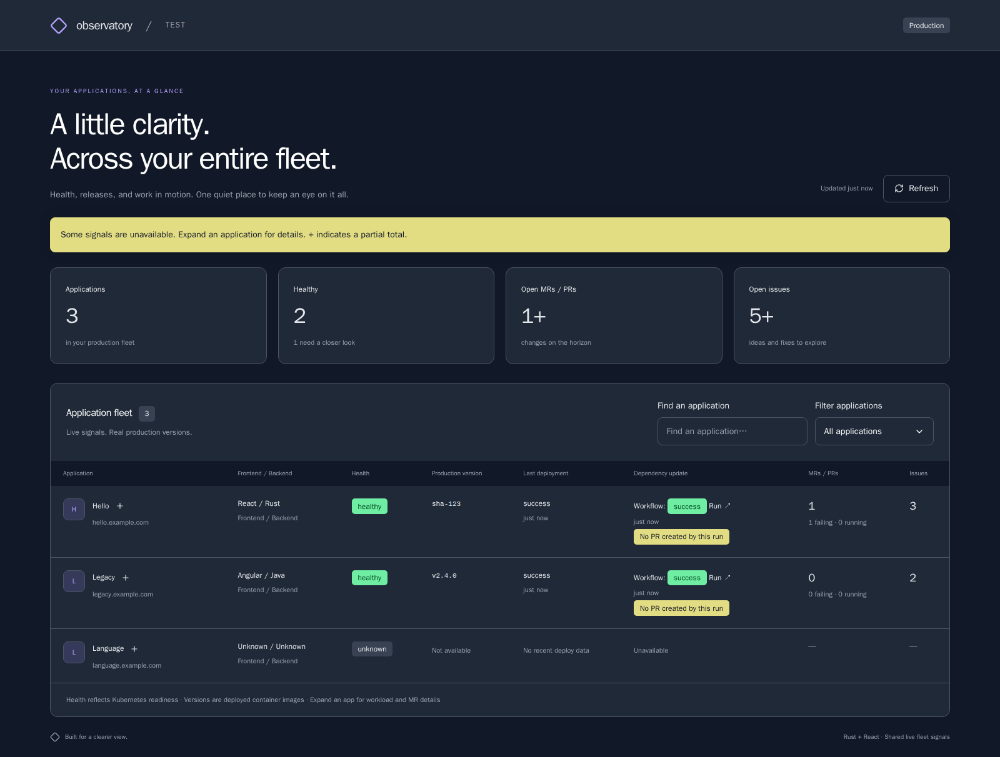
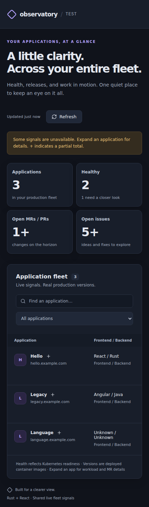

# Application stack previews

## Restored React layout (issue #53)

The last React dashboard is commit `1f597ae` (immediately before the Go/vanilla
rollback). Its production frontend was built in an isolated detached worktree
and served with Vite preview. Both versions below use the same `fleetSnapshot()`
fixture, Chromium, and 1600×1000 / 430×932 viewports; no production data is used.

| View | Last React version | Restored vanilla version |
| --- | --- | --- |
| Desktop | [Reference](react-reference-desktop.png) | [Restored](restored-desktop.png) |
| Mobile | [Reference](react-reference-mobile.png) | [Restored](restored-mobile.png) |

The restoration covers the system font, slate surfaces, purple accents, bright
status badges, header, summary cards, floating control labels, table, disclosures,
dialogs and responsive breakpoints. Native selects and dialogs preserve keyboard
and touch behavior. The footer identifies the actual Go/vanilla stack.

To reproduce the comparisons, build each frontend and serve its `dist` with Vite
preview on a distinct port. From the current checkout run:

```bash
node frontend/scripts/capture-layout-reference.mjs http://127.0.0.1:4174 docs/screenshots/react-reference
node frontend/scripts/capture-layout-reference.mjs http://127.0.0.1:4175 docs/screenshots/restored
```

The script checks for browser exceptions and document overflow. For expanded
rows, issue dialogs, filter menus and mobile Safari, use the existing
`SCREENSHOT_WEBKIT=1 npm --prefix frontend run screenshots` workflow.

## Earlier migration previews

Historical migration screenshots of the React bundle served by the Rust backend, using
illustrative end-to-end fixture data. These are visual-review images, not live
production signals or pixel-diff test baselines.

The fleet shows **React / Rust**, **Angular / Java**, and an undetected stack as
**Unknown / Unknown**.

## Desktop

1600 px viewport, showing the complete fleet table.



## Mobile

430 px viewport, with the horizontally scrollable table positioned to show the
frontend and backend stack column.


