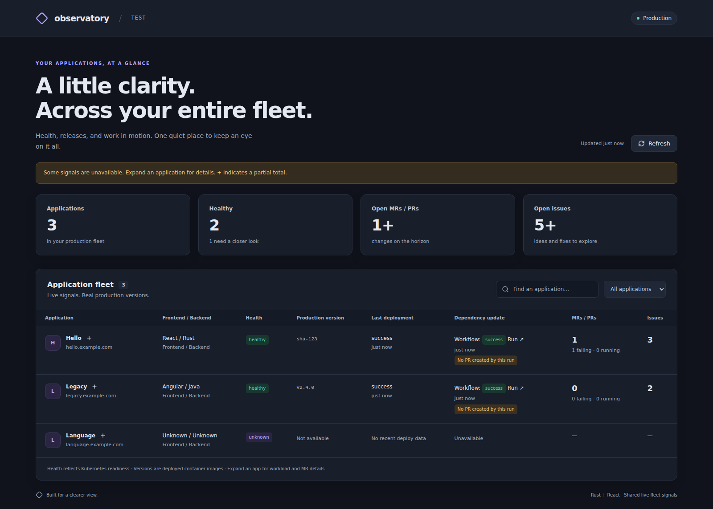
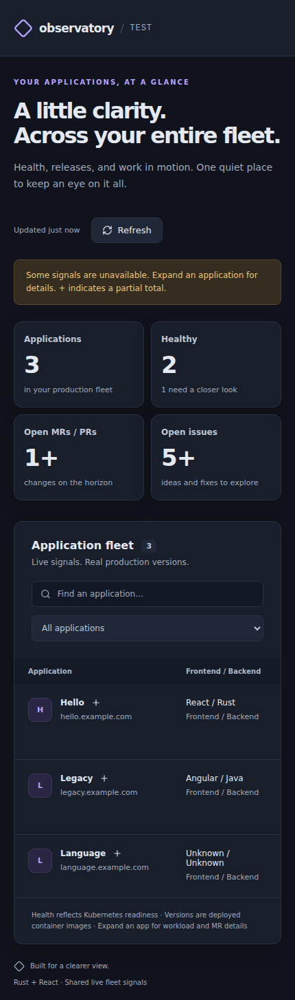

# Application stack previews

Screenshots of the production React bundle served by the Rust backend, using
illustrative end-to-end fixture data. These are visual-review images, not live
production signals or pixel-diff test baselines.

The fleet shows **React / Rust**, **Angular / Java**, and an undetected stack as
**Unknown / Unknown**.

## Desktop

1600 px viewport, showing the complete fleet table.

## Mobile

430 px viewport, with the horizontally scrollable table positioned to show the
frontend and backend stack column.

